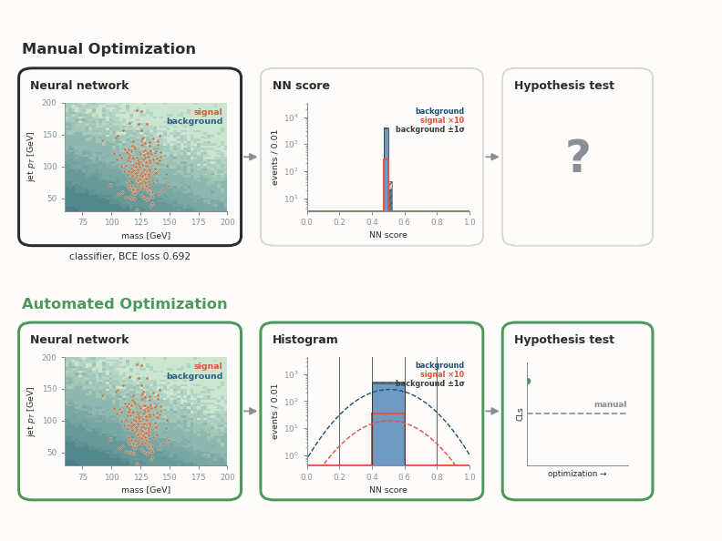
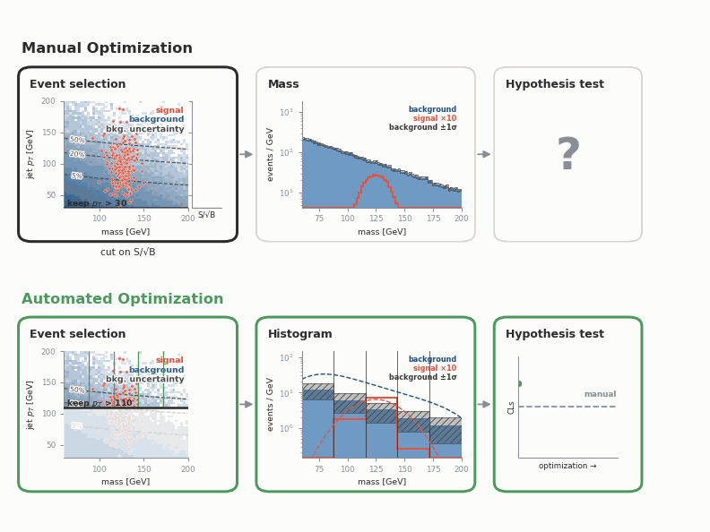

# TOMATOS: auTOMATed Optimization of Sensitivity

End-to-end differentiable optimization of a particle-physics analysis in JAX.

A particle-physics analysis at the LHC is typically optimized iteratively in parts with varying objectives. Uncertainties often have a large impact on the overall sensitivity but only enter fully in the final statistical fit. tomatos is a framework that turns such a chain into a single differentiable procedure and optimizes it directly on the final sensitivity.

## Toy example
Find a small signal in a large background using 2 kinematic features and a background uncertainty with two different analysis strategies. Each GIF shows the manual iterative procedure on top and the automated chain below.

### Neural Network 
Manual optimization uses the features to train a signal/background classifier and optimizes the histogram bins to increase the overall signal-to-background ratio. The sensitivity, including uncertainties, is then obtained in the final hypothesis test. The classifier favours the highest signal-to-background ratio towards the top in the 2D plane, where the background uncertainty increases. The automated optimization instead learns to avoid higher uncertainty regions and reaches a better sensitivity. 



### Event Selection
The same data but now using a selection on jet pT and a fit in the mass variable. The automated chain optimizes the selection and the histogram bins together on the final sensitivity. It selects more inclusively, where the background is better known, and reaches a better sensitivity than the manual one.



## Quickstart

```bash
make install   # Python 3.9 venv in .venv
make demo      # toy data, both trainings, the gifs above
make test      # smoke test
```

```bash
tomatos --config configs/toy_nn.yaml --prep --train --plot
```

Built on [JAX](https://github.com/jax-ml/jax), [equinox](https://github.com/patrick-kidger/equinox), [optax](https://github.com/google-deepmind/optax), [pyhf](https://github.com/scikit-hep/pyhf) and [neos](https://github.com/gradhep/neos).

