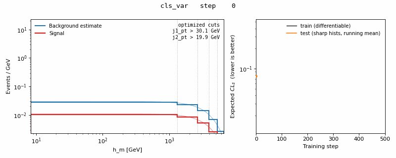
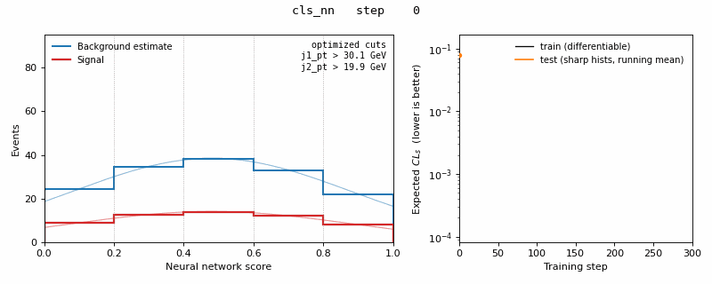

# TOMATOS: auTOMATed Optimization of Sensitivity

**End-to-end differentiable optimization of a particle-physics analysis, from event selection to the final statistical test, written in JAX.**

## The problem

A physics search at the LHC is a long chain of steps: select events with cuts, maybe train a classifier, bin the output into histograms, then fit a statistical model with systematic uncertainties to get the final sensitivity (expected $CL_s$). Each step is usually tuned on its own, against a stand-in objective. Cuts are tuned by hand, a neural network is trained on cross-entropy, binning is chosen by eye. None of these stand-ins knows about the uncertainties that dominate the final result, so the analysis is optimized for the wrong target and needs many rounds of re-tuning.

## What tomatos does

tomatos makes the whole chain differentiable and optimizes everything **directly on the final metric**:

| step | normally | in tomatos |
| --- | --- | --- |
| cuts | hard thresholds | sigmoid cuts with learnable thresholds |
| classifier | trained on cross-entropy | MLP trained on the final sensitivity |
| histograms | hard binning | binned kernel-density estimate with learnable bin edges and bandwidth |
| statistics | separate fit afterwards | differentiable [pyhf](https://github.com/scikit-hep/pyhf) likelihood incl. systematics and a data-driven background estimate |

Gradients flow from the expected $CL_s$ back through the likelihood fit, the histograms and the cuts into the network weights. Cuts, bin edges and the network are then trained together with Adam.

### Optimizing cuts and binning of a variable (`cls_var`)

The dijet invariant mass `h_m` is binned for the fit. The two jet-pT cuts and all bin edges are learned:



As the KDE bandwidth anneals, the bin edges move onto the Higgs-mass peak and the training objective drops about 3x. Evaluated with sharp histograms on held-out events, the result stays noisy: a single variable with five bins leaves little room to improve.

### Optimizing a neural network (`cls_nn`)

An MLP on 11 kinematic inputs is trained so that its score histogram gives the best sensitivity. The cuts are learned at the same time:



The network learns to push signal to high scores and background to low ones. The expected $CL_s$ on held-out test events drops from 0.08 to about 0.002.

Left: signal and the data-driven background estimate in the signal region. Stairs show the binned KDE; lines show the underlying KDE. The `cls_var` panel uses log axes because the bins start out spanning the full mass range. Right: expected $CL_s$ during training, for the smooth training objective and for sharp (true) histograms on held-out test data.

The demo uses a small sample built from [ATLAS Open Data](https://opendata.atlas.cern) (ZH → ννbb̄ as signal, collision data as background), committed in `tests/files/`.

## Quickstart

```bash
make install   # Python 3.9 venv in .venv
make demo      # preprocess, train and plot both demos, render the GIFs
make test      # smoke test: a few training steps per objective
```

On a laptop CPU the full demo takes about 2.5 hours (500 + 300 steps at 10–15 s each). The smoke test takes about 3 minutes.

The dependency stack is pinned to `jax==0.3.14` because the likelihood fit relies on `jaxopt`, which is retired and incompatible with newer JAX. The install therefore needs Python 3.9. `make install` runs these steps:

```bash
python3.9 -m venv .venv
source .venv/bin/activate
pip install --upgrade pip
export SKLEARN_ALLOW_DEPRECATED_SKLEARN_PACKAGE_INSTALL=True
pip install --editable .
pip install jaxlib==0.3.14 -f https://storage.googleapis.com/jax-releases/jax_releases.html
```

Run a single config:

```bash
tomatos --config configs/demo_cls_nn.yaml --prep --train --plot
```

Outputs (metrics, models, plots, an mp4 of the histogram evolution) land in `results/`.

## Layout

| module | role |
| --- | --- |
| `config.py` | reads the YAML config, sets up the sample/systematic structure and output paths |
| `preprocess.py` | ROOT ntuples → upsampled, shuffled, min-max scaled train/valid/test arrays (HDF5) |
| `batcher.py` | streams batches from disk |
| `select.py` | differentiable cuts and region selection via event weights |
| `histograms.py` | differentiable histograms (binned KDE), NN forward pass |
| `workspace.py` | background estimate, systematics and the pyhf model |
| `pipeline.py` | the loss: cuts → histograms → likelihood → $CL_s$ |
| `training.py`, `solver.py`, `constraints.py` | optimization loop, Adam with a one-cycle schedule, parameter limits |
| `nn.py` | the MLP (equinox) |
| `plotting.py` | diagnostics and the training movie |

Built with [JAX](https://github.com/jax-ml/jax), [equinox](https://github.com/patrick-kidger/equinox), [optax](https://github.com/google-deepmind/optax), [pyhf](https://github.com/scikit-hep/pyhf), [relaxed](https://github.com/gradhep/relaxed) and [neos](https://github.com/gradhep/neos).

## License

Apache 2.0
